# Arquitectura de ejecución de Infracture

[Volver al README principal](../README.md)

Este documento explica cómo Infracture convierte un diagrama dibujado en el canvas en un experimento real sobre Docker, y cómo lo observa, lo detiene y lo conserva en el historial. Recorre el camino completo: el catálogo de componentes, las reglas que unen los nodos, la validación, la compilación a Docker, el ciclo de vida de una ejecución y las evidencias que produce.

Está escrito para dos lectores: quien vaya a programar el motor y quien quiera entender el funcionamiento sin leer el código. Los términos siguen el [glosario](../GLOSSARY.md). Las decisiones que fijan este diseño están en los [ADR](adr/) y los criterios de aceptación en la [spec de la Fase 3](PHASE_3_SPEC.md).

> **Estado.** Este documento describe el diseño aprobado el 30 de octubre de 2026 para Infracture 0.1.0. En `main` existen el catálogo de fichas, los proyectos y los escenarios; el guardado del grafo está en desarrollo (#79). El motor de ejecución, la observación y el historial están pendientes. Cada sección indica las piezas que quedan fuera de la Fase 3.

Los 18 diagramas utilizan el mismo estilo manuscrito. Se pueden editar en el [tablero de tldraw](https://www.tldraw.com/f/X_Wr0fqaWTqaOOYIWoRFA) o descargar juntos en el [archivo fuente `.tldr`](images/execution-architecture/execution-architecture.tldr).

## Índice

- [1. La idea en una página](#1-la-idea-en-una-página)
- [2. Vocabulario esencial](#2-vocabulario-esencial)
- [3. Plataforma y experimento](#3-plataforma-y-experimento)
- [4. El catálogo controlado](#4-el-catálogo-controlado)
- [5. Perfiles, puertos y capacidades](#5-perfiles-puertos-y-capacidades)
- [6. El escenario y su guardado](#6-el-escenario-y-su-guardado)
- [7. La carga (Workload)](#7-la-carga-workload)
- [8. La validación](#8-la-validación)
- [9. El motor de ejecución](#9-el-motor-de-ejecución)
- [10. Ciclo de vida de una Execution](#10-ciclo-de-vida-de-una-execution)
- [11. Observación: salud, métricas y eventos](#11-observación-salud-métricas-y-eventos)
- [12. Snapshot e historial](#12-snapshot-e-historial)
- [13. Recorridos de ejemplo](#13-recorridos-de-ejemplo)
- [14. Load Balancer](#14-load-balancer)
- [15. Evolución fuera de la Fase 3](#15-evolución-fuera-de-la-fase-3)
- [16. Mapa al código](#16-mapa-al-código)
- [17. Decisiones y referencias](#17-decisiones-y-referencias)

## 1. La idea en una página

Infracture no ejecuta imágenes ni comandos que elija el usuario. Ofrece un **catálogo cerrado** de piezas cuyo comportamiento conoce: un servicio HTTP, un Worker, PostgreSQL, Redis, RabbitMQ y un Load Balancer. La variedad no sale de permitir código arbitrario. Sale de combinar esas piezas, elegir para cada una un **perfil** de comportamiento, unirlas con **conexiones** y aplicarles una **carga**.

El recorrido completo tiene cinco etapas:

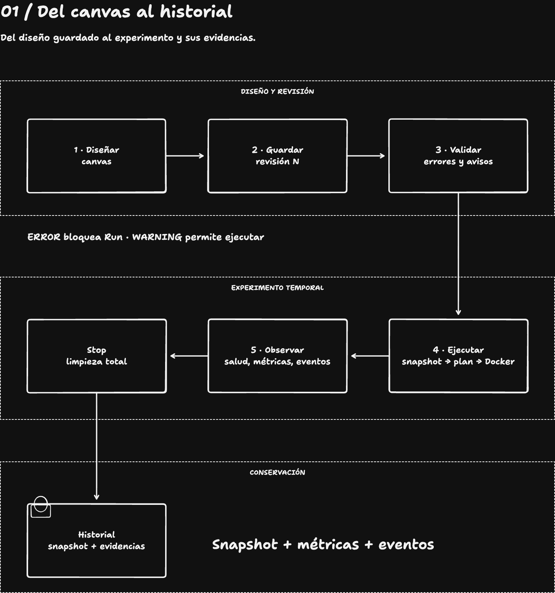

1. **Diseñar.** El usuario coloca nodos en el canvas, elige su perfil y sus parámetros, los une con flechas y configura la carga.
2. **Guardar.** El grafo completo se guarda con un número de revisión. Un borrador incompleto también se puede guardar.
3. **Validar.** El backend comprueba que el diseño cumple los contratos del catálogo. Los errores bloquean la ejecución; los avisos no.
4. **Ejecutar.** `Run` congela esa revisión en un snapshot, la traduce a un plan con forma de fichero Docker Compose y lo aplica sobre Docker.
5. **Observar.** El backend espera a que todo esté sano, lanza la carga y recoge métricas y eventos hasta que alguien pulsa `Stop` o se agota el tiempo.

Tres ideas sostienen todo el diseño:

- **El contrato manda.** Cada tipo de nodo tiene un contrato que dice qué se puede configurar, qué necesita y qué ofrece. El canvas, la validación y el motor leen ese mismo contrato.
- **Se ejecuta exactamente lo que se validó.** Una ejecución queda ligada a una revisión concreta y a una copia inmutable de ella.
- **Nada queda abandonado.** Cada recurso de Docker lleva etiquetas de Infracture, y cualquier forma de terminar acaba retirándolos todos.

## 2. Vocabulario esencial

| Término | Qué es | Ejemplo |
| --- | --- | --- |
| `ComponentType` | Familia de comportamiento que Infracture sabe ejecutar. | HTTP Service, Redis. |
| `Template contract` | Definición que el backend conoce para un tipo: perfiles, parámetros, puertos y capacidades. | Contrato del HTTP Service. |
| Perfil | Forma concreta de comportarse que ofrece un tipo. | `CACHE_ASIDE`. |
| Puerto | Hueco de salida con nombre de un perfil, que pide una capacidad. | `cache` pide `KEY_VALUE`. |
| Capacidad | Lo que un perfil ofrece a quien se conecta a él. | Redis ofrece `KEY_VALUE`. |
| `ComponentTemplate` | Ficha del catálogo que gestiona el administrador: nombre, icono y configuración inicial. | «API con caché». |
| `Component` | Nodo concreto del canvas, creado a partir de una ficha. | `orders-api`. |
| `Connection` | Flecha que sale de un puerto de un nodo hacia otro nodo. Significa «depende de». | `orders-api.cache → cache`. |
| `Workload` | Carga del escenario: objetivo, perfil de carga, parámetros y semilla. | `REPEATED_READ` a 10 peticiones/s. |
| `Scenario revision` | Número que identifica el estado exacto guardado de un escenario. | Revisión 8. |
| `ValidationIssue` | Problema que encuentra la validación, con severidad y objetivo. | ERROR en el puerto `cache`. |
| `Execution` | Experimento lanzado desde una revisión. | Ejecución del 30 de octubre. |
| `Execution snapshot` | Copia inmutable de lo que se ejecutó. | Revisión 8, imágenes y plan. |
| `ExecutionPlan` | Traducción del snapshot a servicios Docker, con forma de fichero Compose. | Servicios, red y salud. |
| `ExecutedComponent` | Identidad histórica de un nodo dentro de una ejecución. | `orders-api` en la ejecución 12. |

## 3. Plataforma y experimento

Hay que distinguir dos mundos que conviven en la misma máquina:

- **La plataforma** es Infracture: está siempre encendida y guarda los datos de los usuarios.
- **El experimento** es temporal: nace con `Run` y desaparece con `Stop`.

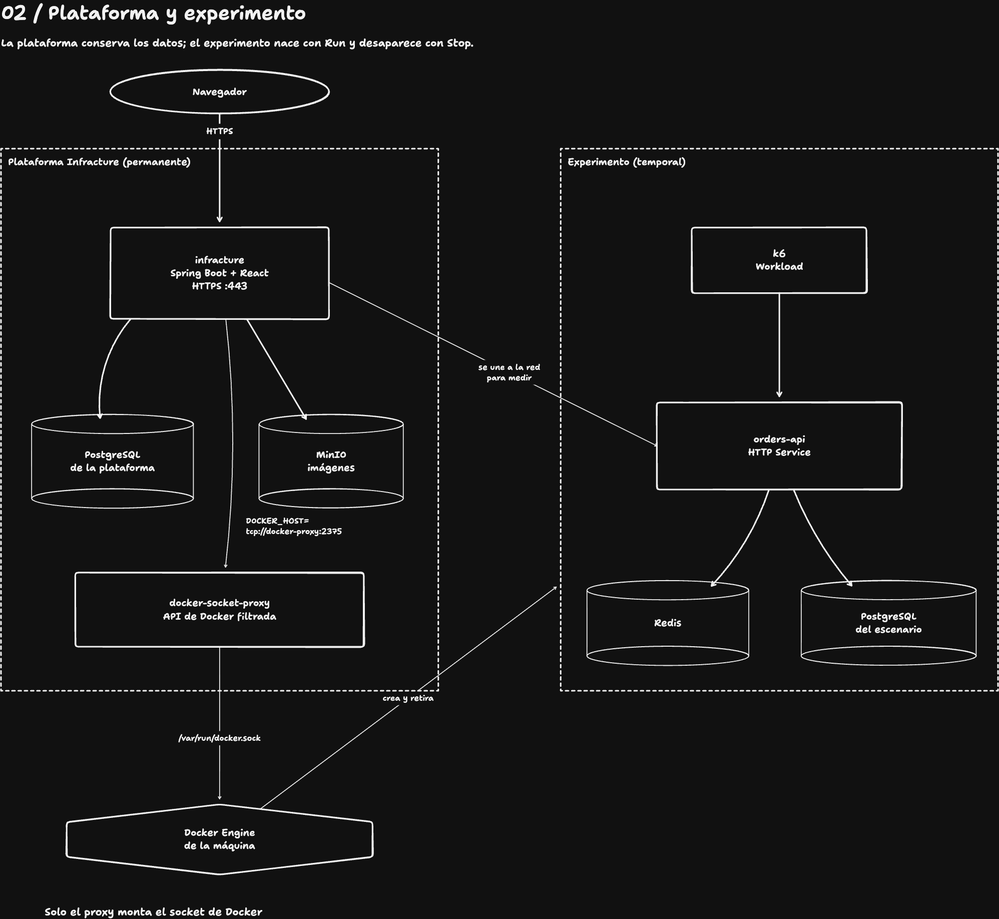

- **Dos PostgreSQL distintos.** El de la plataforma guarda usuarios, proyectos, escenarios y ejecuciones. El PostgreSQL que el usuario arrastra al canvas es otro contenedor, creado solo para el experimento. Comparten tecnología, pero no comparten datos, credenciales, red ni ciclo de vida.
- **Docker de la máquina con proxy.** El backend no monta el socket de Docker. Solo lo monta `docker-socket-proxy`, que deja pasar las operaciones que el motor necesita (contenedores, redes, volúmenes, imágenes) y rechaza las demás. Los contenedores del experimento nunca tienen acceso a Docker ([ADR 0013](adr/0013-motor-de-ejecucion-con-docker-compose.md)).
- **Un proyecto Compose por ejecución.** Cada `Execution` vive en su propio proyecto Compose (por ejemplo `infracture-exec-12`), con su red aislada y sus etiquetas. Así se distingue de la plataforma y de cualquier otro contenedor del usuario.

Durante una ejecución trabajan dos planos:

| Plano | Quién | Qué hace |
| --- | --- | --- |
| Control | Backend de Infracture | Crea y retira recursos, espera la salud, recoge métricas y eventos, informa al navegador. |
| Datos | Contenedores del experimento | Se envían peticiones y mensajes entre ellos: carga → servicio → caché, base de datos o cola. |

El backend organiza y observa el experimento, pero no ejecuta su lógica de negocio ni envía cada petición de la carga.

## 4. El catálogo controlado

### 4.1 Tres niveles: tipo, contrato y ficha

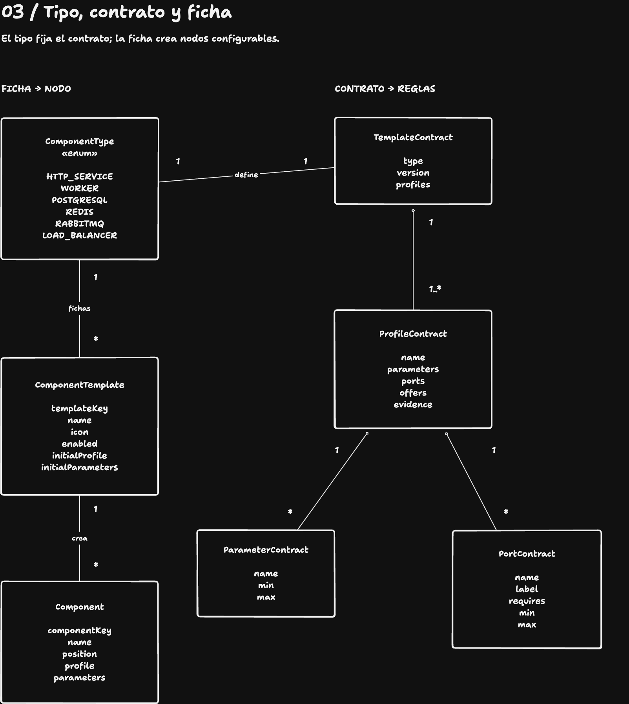

| Nivel | Quién lo cambia | Cómo cambia | Dónde vive |
| --- | --- | --- | --- |
| `ComponentType` | Desarrollo | Con código y una release. | Enum de Java y `CHECK` de la base de datos. |
| `Template contract` | Desarrollo | Con código, una release y, si es incompatible, una migración. | Código del backend (`ContractCatalog`). |
| `ComponentTemplate` | Administrador | Desde el panel, dentro de lo que permite el contrato. | Tabla `component_template`. |
| `Component` | Usuario | Desde el canvas, dentro de lo que permite el contrato. | Tabla `components`. |

- **El contrato es código, no datos.** El administrador no puede crear perfiles, imágenes ni comandos. Solo crea fichas que eligen una configuración inicial válida. Así Infracture sabe siempre cómo validar, arrancar y medir cada nodo ([ADR 0003](adr/0003-catalogo-controlado-con-contratos-versionados.md)).
- **La configuración inicial es de la ficha.** Dos fichas del mismo tipo pueden empezar distinto, por ejemplo «API rápida» con 0 ms de retardo y «API lenta» con 500 ms. Un nodo nuevo copia la configuración de su ficha. Si después el administrador la cambia, los nodos ya creados no cambian.
- **Los parámetros son enteros.** Todos los parámetros del catálogo son números enteros con mínimo y máximo. Un decimal se rechaza al guardar.
- **Siempre hay un perfil.** Los tipos sin variantes (PostgreSQL, Redis y RabbitMQ) tienen un único perfil `DEFAULT`, y el Worker tiene `CONSUMER`. Así todos los nodos se tratan igual.
- **El catálogo se inyecta.** `ContractCatalog` es un bean de Spring que reciben los servicios y el validador. Las entidades no lo consultan por su cuenta, y en las pruebas se puede sustituir por un catálogo pequeño.

### 4.2 Una sola versión ejecutable

El backend solo conoce **la versión actual** de cada contrato ([ADR 0010](adr/0010-una-sola-version-ejecutable-del-contrato.md)). Cuando un cambio del contrato deja de admitir algo que ya está guardado, se publica junto con una migración de Flyway que actualiza los nodos y las fichas guardados.

Por ejemplo, la versión 2 del HTTP Service renombra `responseDelayMs` a `latencyMs` y baja su máximo de 5000 a 2000:

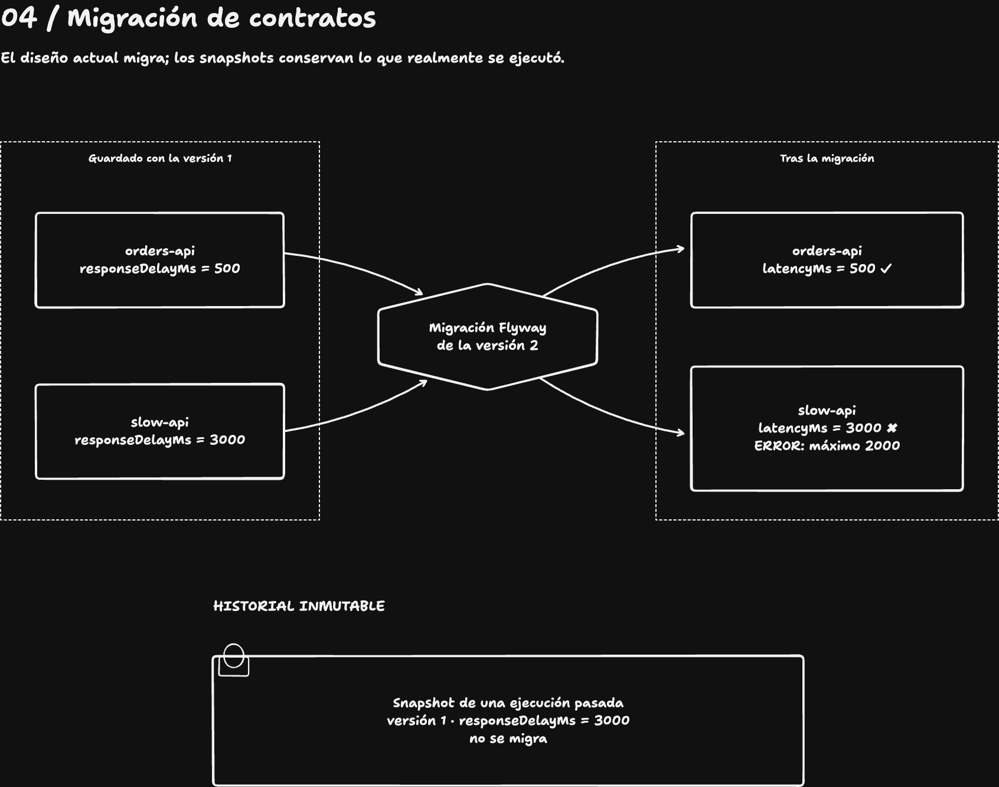

- **Lo convertible se convierte.** El valor 500 cabe en el nuevo rango y pasa a `latencyMs`.
- **Lo que no se puede convertir se marca.** El valor 3000 se conserva, pero la validación devuelve un error que bloquea `Run` hasta que el usuario elija un valor válido. No se pierde nada sin aviso.
- **El historial no cambia.** El snapshot de una ejecución pasada sigue diciendo «versión 1, `responseDelayMs` = 3000», porque eso es lo que se ejecutó.
- **La imagen no cuenta como versión.** Corregir un error de la imagen de demostración no crea una versión nueva. La imagen y su digest van con la release de Infracture y quedan anotados en cada snapshot.

## 5. Perfiles, puertos y capacidades

### 5.1 Cómo encaja una conexión

Cada perfil declara dos cosas:

- **Sus puertos.** Huecos de salida con nombre. Cada puerto pide una capacidad y admite un número mínimo y máximo de conexiones.
- **Sus capacidades.** Lo que ofrece a quien se conecte a él.

Una conexión es válida cuando el nodo de destino ofrece la capacidad que pide el puerto de origen ([ADR 0011](adr/0011-puertos-con-nombre-que-piden-capacidades.md)).

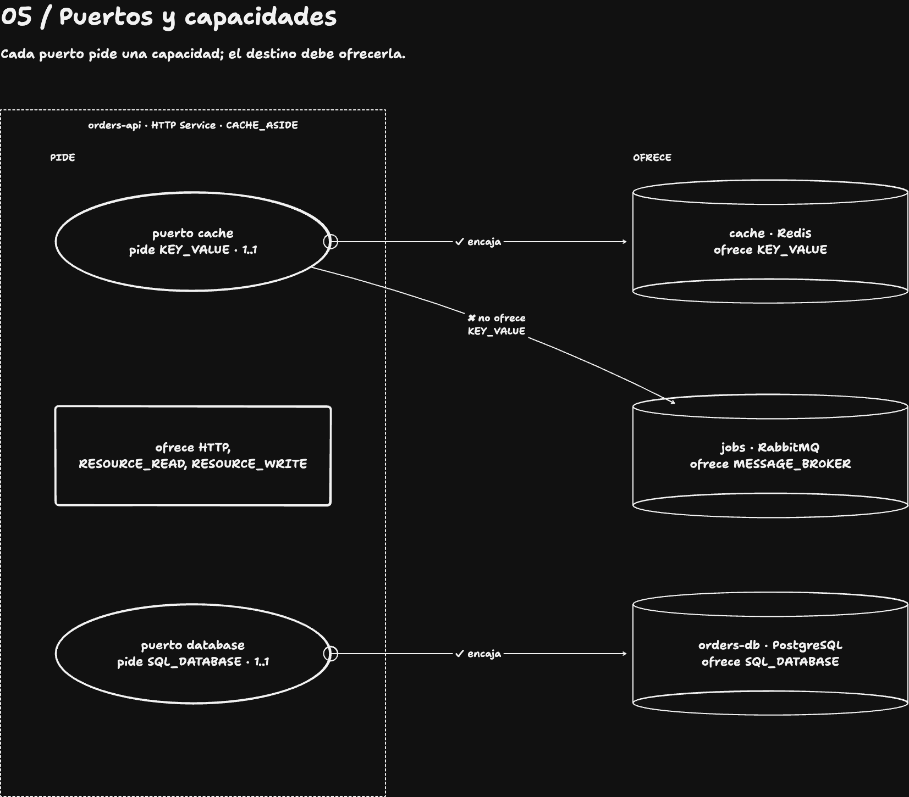

Es como un portátil: cada puerto tiene nombre y forma, y acepta cualquier aparato que hable ese protocolo, sea de la marca que sea. Gracias a eso, el Load Balancer encajará en cualquier puerto que pida `HTTP` sin tocar las reglas del HTTP Service.

### 5.2 Capacidades del catálogo

| Capacidad | Significado | La ofrecen |
| --- | --- | --- |
| `HTTP` | Acepta peticiones HTTP. | Todos los perfiles del HTTP Service y el Load Balancer. |
| `RESOURCE_READ` | Permite leer recursos (`GET /items/{id}`). | `DATABASE_CRUD`, `CACHE_ASIDE`. |
| `RESOURCE_WRITE` | Permite crear y modificar recursos (`POST`, `PUT`). | `DATABASE_CRUD`, `CACHE_ASIDE`. |
| `TASK_CREATE` | Permite crear tareas asíncronas (`POST /tasks`). | `QUEUE_PRODUCER`. |
| `SQL_DATABASE` | Base de datos relacional. | PostgreSQL. |
| `KEY_VALUE` | Almacén clave-valor. | Redis. |
| `MESSAGE_BROKER` | Cola de mensajes. | RabbitMQ. |

### 5.3 Perfiles por tipo

**HTTP Service.** Una única imagen de demostración que cambia de comportamiento según el perfil.

| Perfil | Comportamiento | Puertos (capacidad · cardinalidad) | Ofrece |
| --- | --- | --- | --- |
| `STATELESS` | Responde sin consultar nada. | Ninguno. | `HTTP` |
| `DATABASE_CRUD` | Lee, crea y actualiza recursos en PostgreSQL. | `database` (`SQL_DATABASE` · 1) | `HTTP`, `RESOURCE_READ`, `RESOURCE_WRITE` |
| `CACHE_ASIDE` | Lee primero de la caché; si falla, lee de la base de datos y rellena la caché. Al modificar, actualiza la base de datos e invalida la caché. | `cache` (`KEY_VALUE` · 1), `database` (`SQL_DATABASE` · 1) | `HTTP`, `RESOURCE_READ`, `RESOURCE_WRITE` |
| `QUEUE_PRODUCER` | Convierte cada petición en una tarea y responde `202 Accepted`. | `queue` (`MESSAGE_BROKER` · 1), etiqueta «Publica en» | `HTTP`, `TASK_CREATE` |
| `DOWNSTREAM_HTTP` | Llama a otro servicio HTTP y compone la respuesta. | `downstream` (`HTTP` · 1) | `HTTP` |

**Worker.**

| Perfil | Comportamiento | Puertos | Ofrece |
| --- | --- | --- | --- |
| `CONSUMER` | Consume tareas, las procesa con una duración simulada, las confirma y reintenta un número acotado de veces. | `queue` (`MESSAGE_BROKER` · 1), etiqueta «Consume de»; `result` (`SQL_DATABASE` o `KEY_VALUE` · 0..1) | Nada |

**Dependencias.**

| Tipo | Perfil | Ofrece | Notas |
| --- | --- | --- | --- |
| PostgreSQL | `DEFAULT` | `SQL_DATABASE` | Datos iniciales controlados por Infracture. |
| Redis | `DEFAULT` | `KEY_VALUE` | Sin persistencia; política de memoria segura. |
| RabbitMQ | `DEFAULT` | `MESSAGE_BROKER` | Cola controlada, con la interfaz de gestión para leer métricas. |

Cada perfil declara también los nombres de sus **evidencias**, es decir, las métricas que producirá al ejecutarse ([sección 11](#11-observación-salud-métricas-y-eventos)). Los fallos que admite cada nodo no se declaran todavía, porque están fuera de la Fase 3.

### 5.4 Qué significa una flecha

Una flecha `A → B` significa siempre **«A depende de B»**: A necesita a B para hacer su trabajo. Esa dirección no siempre coincide con el recorrido de los datos. En mensajería, por ejemplo, ambas flechas apuntan a RabbitMQ:

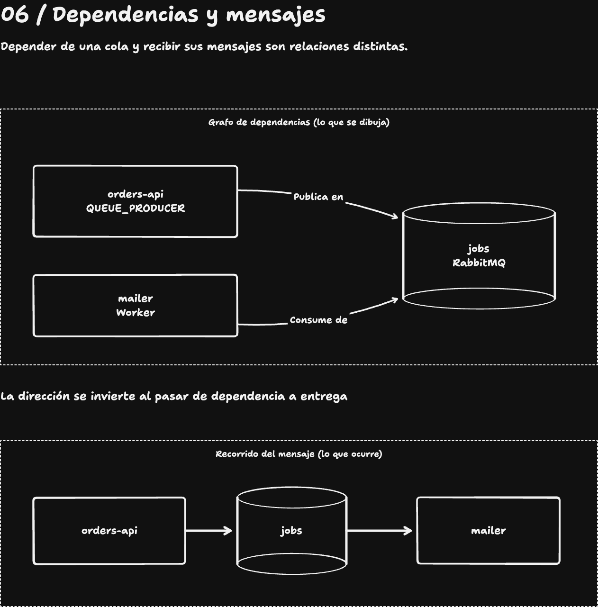

Por eso cada puerto tiene una etiqueta visible, como «Publica en» o «Consume de», que evita la ambigüedad.

### 5.5 El grafo no puede tener ciclos

El grafo de dependencias completo debe ser **acíclico**. Si A depende de B y B depende de A, ninguno de los dos puede arrancar primero. Esta regla cubre las autollamadas, los ciclos HTTP y los ciclos indirectos que aparecerían con un Load Balancer.

El orden topológico del grafo es además el **orden de arranque**: primero arrancan los nodos sin dependencias y después los que dependen de ellos.

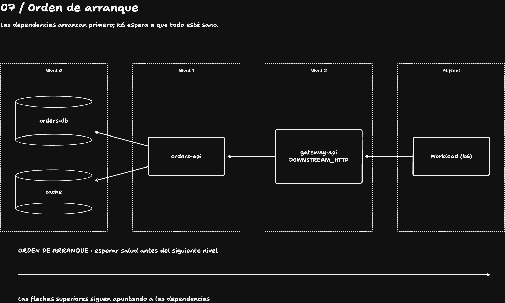

## 6. El escenario y su guardado

El `Scenario` es el grafo editable: sus nodos, sus conexiones y su `Workload`. Se guarda **entero** en cada guardado. El ADR 0009, que llega con #79, recoge esta decisión.

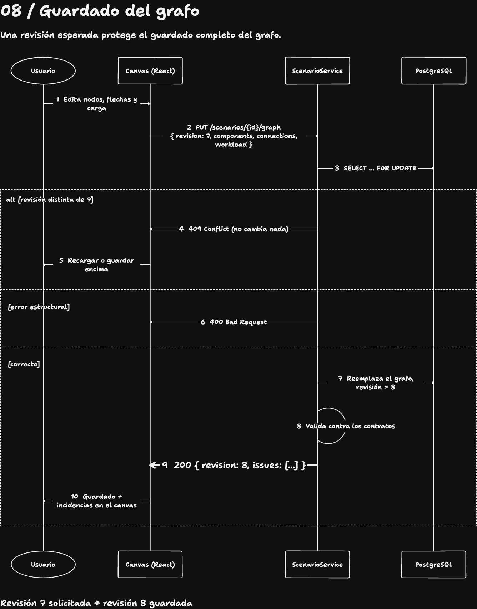

- **Revisión esperada.** El cliente envía la revisión de la que partió. Si otra pestaña guardó antes, el servidor responde `409` y no sobrescribe nada.
- **Claves estables.** Cada nodo tiene un `componentKey` (UUID) que genera el navegador. Las conexiones y el `Workload` apuntan a esas claves, que se conservan entre guardados.
- **Borrador permitido.** Un escenario vacío o incompleto se puede guardar. Solo se rechaza lo que rompería la coherencia del grafo (sección 8).
- **Borrar un nodo** elimina sus conexiones en la misma operación. Si el nodo era el objetivo del `Workload`, el `Workload` se conserva sin objetivo y aparece un error.

## 7. La carga (Workload)

La carga no es un nodo del canvas: es un **ajuste del escenario** ([ADR 0012](adr/0012-la-carga-es-un-workload-del-escenario.md)). En el canvas se dibuja como una flecha de tráfico que entra en su objetivo.

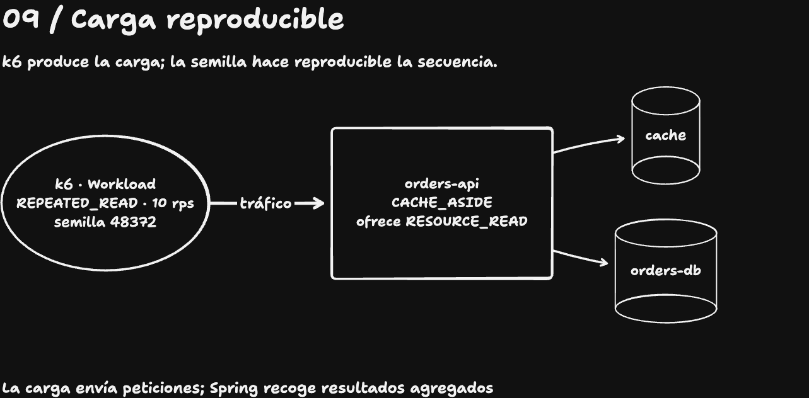

### 7.1 Qué contiene

| Campo | Qué es |
| --- | --- |
| Objetivo | Clave del `Component` que recibe la carga. Debe ofrecer la capacidad que pide el perfil. |
| Perfil de carga | Uno de los cuatro de la tabla siguiente. |
| Parámetros | Enteros acotados: peticiones por segundo, usuarios virtuales concurrentes, duración, tamaño del conjunto de datos, pesos… |
| Semilla | Número que hace reproducible la secuencia de decisiones aleatorias. |

Hay como máximo un `Workload` por escenario. Se guarda en la tabla `scenario_workload`, en el mismo guardado y con la misma revisión que el grafo, y entra en el snapshot.

### 7.2 Perfiles de carga

| Perfil | Qué hace | Pide al objetivo |
| --- | --- | --- |
| `CONSTANT_HTTP` | Repite una petición a frecuencia constante. | `HTTP` |
| `REPEATED_READ` | Lee una y otra vez un conjunto pequeño de recursos. Sirve para calentar una caché y ver aciertos y fallos. | `RESOURCE_READ` |
| `WEIGHTED_CRUD` | Mezcla lecturas, creaciones y actualizaciones con pesos, por ejemplo 80 % `GET`, 10 % `POST` y 10 % `PUT`. Admite secuencias con estado: crear, leer el recurso creado y modificarlo. | `RESOURCE_READ`, `RESOURCE_WRITE` |
| `TASK_PRODUCER` | Crea tareas continuamente con `POST /tasks`. | `TASK_CREATE` |

`TASK_PRODUCER` solo encaja con `QUEUE_PRODUCER`, porque es el único perfil que ofrece `TASK_CREATE`. El generador no sabe si su objetivo usa Redis, PostgreSQL o RabbitMQ: solo ve su API HTTP.

### 7.3 Cómo se genera

La carga la produce **Grafana k6** dentro de una imagen controlada por Infracture. Esa imagen trae **un script fijo por perfil**. El backend no genera código: solo pasa números por variables de entorno.

```text
WORKLOAD_PROFILE=REPEATED_READ
TARGET_URL=http://orders-api:8080
REQUESTS_PER_SECOND=10
VIRTUAL_USERS=5
DATASET_SIZE=20
RANDOM_SEED=48372
```

Cada usuario virtual de k6 repite un bucle: elige una operación permitida, genera sus datos con la semilla, envía la petición, anota el código y la latencia, y espera según la frecuencia configurada. k6 agrega los resultados y el backend los recoge por intervalos; Spring no envía las peticiones una a una.

- **Sin carga se puede ejecutar.** Un escenario sin `Workload` muestra la advertencia «no habrá tráfico» y deja ejecutar, por ejemplo para observar solo el arranque y el consumo.
- **La carga arranca la última.** Solo empieza cuando todos los servicios están sanos, para que los resultados se puedan interpretar.

## 8. La validación

### 8.1 Dos niveles

| Nivel | Cuándo | Qué comprueba | Resultado |
| --- | --- | --- | --- |
| **Estructural** | Al guardar | Que el grafo sea coherente: claves válidas y únicas, referencias dentro del escenario, fichas existentes y habilitadas para nodos nuevos, tipos y nombres conocidos, parámetros enteros. | `400 Bad Request`. No se guarda nada. |
| **De contrato** | Al guardar, al pulsar `Run` y al reservar la ejecución | Que el diseño se pueda ejecutar: perfil reconocido, parámetros dentro de límites, puertos obligatorios conectados, cardinalidades, capacidades compatibles, grafo acíclico, objetivo y perfil de la carga, cuotas de la instancia. | Lista de `ValidationIssue`. El borrador se guarda igualmente. |

La separación permite guardar un trabajo a medias sin perder nada, y a la vez impedir que se ejecute algo incorrecto. El backend repite la validación al reservar la ejecución, así que un cliente manipulado no puede saltársela.

### 8.2 Errores y advertencias

- **ERROR.** Impide construir un plan ejecutable y bloquea `Run`. Por ejemplo, `CACHE_ASIDE` sin Redis o un ciclo de dependencias.
- **WARNING.** Deja ejecutar, pero avisa de un efecto probable. Por ejemplo, un escenario sin `Workload` o un RabbitMQ con productores pero sin Worker: acumular mensajes puede ser justo lo que se quiere estudiar.

### 8.3 Forma de una incidencia

```json
{
  "severity": "ERROR",
  "code": "MISSING_CONNECTION",
  "message": "El puerto cache de orders-api necesita una conexión a algo que ofrezca KEY_VALUE.",
  "target": { "kind": "COMPONENT", "key": "6f1c…" },
  "field": "cache"
}
```

| Campo | Para qué sirve |
| --- | --- |
| `severity` | `ERROR` o `WARNING`. |
| `code` | Identificador estable para la interfaz y las pruebas, por ejemplo `MISSING_CONNECTION`, `CAPABILITY_MISMATCH`, `DEPENDENCY_CYCLE`, `PARAMETER_OUT_OF_RANGE` o `WORKLOAD_WITHOUT_TARGET`. |
| `message` | Texto para el usuario. |
| `target` | Qué está mal: un `COMPONENT`, una `CONNECTION`, el `WORKLOAD` o el `SCENARIO`, con su clave. |
| `field` | Opcional: el parámetro o puerto concreto. Permite al canvas marcar justo ese campo. |

### 8.4 Validez estática no es salud

Que un diseño sea válido significa que **se puede intentar** ejecutarlo. No garantiza que todos los procesos arranquen: una imagen puede no descargarse o un servicio puede no responder. Esa comprobación dinámica la hacen las comprobaciones de salud del motor ([sección 9.4](#94-arranque-ordenado-por-salud)).

## 9. El motor de ejecución

### 9.1 Cuatro piezas

El motor se divide en cuatro piezas con una responsabilidad cada una ([ADR 0013](adr/0013-motor-de-ejecucion-con-docker-compose.md)):

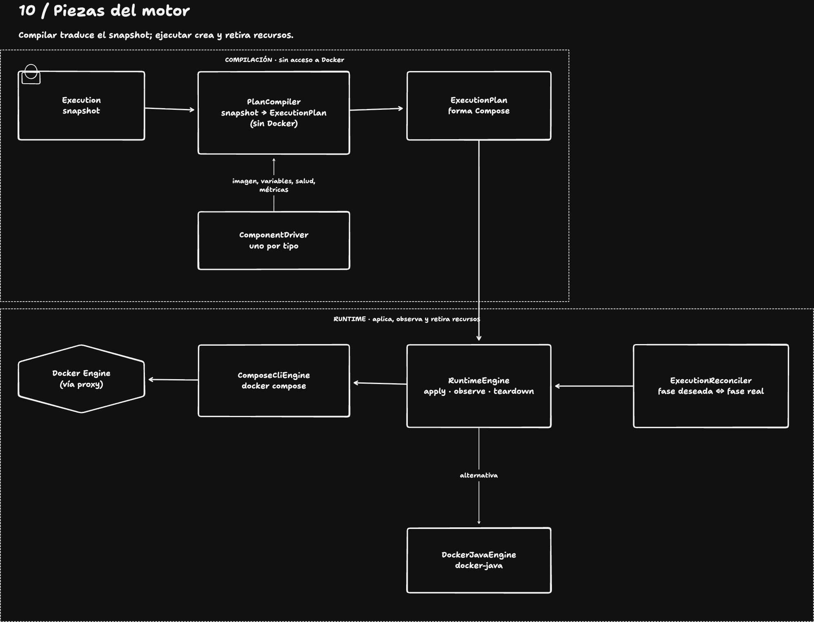

| Pieza | Responsabilidad | Cómo se prueba |
| --- | --- | --- |
| `PlanCompiler` | Traduce un snapshot a un `ExecutionPlan`: nombres, alias, red, variables, salud, dependencias, límites y etiquetas. No toca Docker. | Pruebas unitarias con ficheros de referencia: dado este snapshot, este plan. |
| `ComponentDriver` | Uno por `ComponentType`. Sabe qué imagen usa ese tipo, qué variables necesita cada perfil, cómo se comprueba su salud y de dónde se leen sus métricas. | Pruebas unitarias por tipo. |
| `RuntimeEngine` | Aplica un plan, observa su estado y lo retira. Tiene dos implementaciones: `docker compose` (la principal) y `docker-java` (la alternativa). | Pruebas de integración con Docker real. |
| `ExecutionReconciler` | Compara la fase deseada de cada ejecución con la real y actúa hasta igualarlas. | Pruebas unitarias con un `RuntimeEngine` simulado; pruebas de extremo a extremo con Docker. |

Añadir un tipo nuevo, como el Load Balancer, consiste en declarar su contrato y escribir su driver. Cambiar de `docker compose` a `docker-java` solo afecta al `RuntimeEngine`.

Se llama *reconciler* y no *controller* porque en el repositorio el sufijo `Controller` está reservado a los controladores REST.

### 9.2 Qué ocurre al pulsar Run

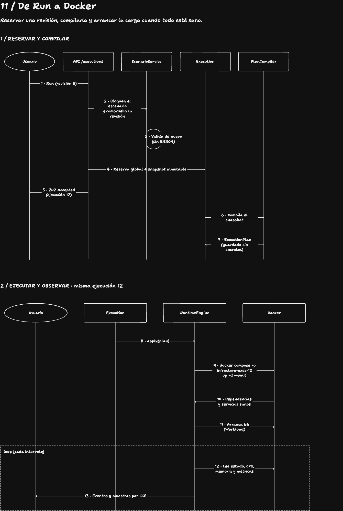

- **Una sola ejecución activa.** La instancia local admite una única `Execution` reservada, arrancando, activa o limpiándose. Un segundo `Run`, aunque sea de otro usuario, se rechaza.
- **Run es idempotente.** Un doble clic o un reintento tras un corte de red no crean otra ejecución ni recursos duplicados.
- **El escenario queda en solo lectura** desde la reserva hasta que termina la limpieza.
- **Sin transacciones abiertas esperando a Docker.** La reserva y el snapshot se confirman en la base de datos antes de llamar a Docker. Lo que ocurre después se registra como eventos.

### 9.3 El ExecutionPlan

El plan tiene la forma de un fichero Docker Compose. Este es un extracto simplificado para el escenario `CACHE_ASIDE`:

```yaml
name: infracture-exec-12
networks:
  exec:
    labels: { io.infracture.execution: "12" }
services:
  orders-db:
    image: postgres:18@sha256:…
    environment:
      POSTGRES_PASSWORD_FILE: /run/secrets/orders-db   # referencia, no el valor
    healthcheck: { test: ["CMD", "pg_isready"], interval: 2s, retries: 30 }
    labels: { io.infracture.execution: "12", io.infracture.component: "orders-db" }
    deploy: { resources: { limits: { cpus: "0.5", memory: 256M } } }
  cache:
    image: redis:8@sha256:…
    healthcheck: { test: ["CMD", "redis-cli", "ping"], interval: 2s, retries: 30 }
    labels: { io.infracture.execution: "12", io.infracture.component: "cache" }
  orders-api:
    image: infracture/demo-app:0.1.0@sha256:…
    environment:
      APP_ROLE: http
      APP_MODE: CACHE_ASIDE
      CACHE_URL: redis://cache:6379
      DATABASE_URL: postgresql://orders-db:5432/app
      RESPONSE_DELAY_MS: "0"
    depends_on:
      orders-db: { condition: service_healthy }
      cache: { condition: service_healthy }
    healthcheck: { test: ["CMD", "wget", "-qO-", "http://localhost:8080/health"] }
    labels: { io.infracture.execution: "12", io.infracture.component: "orders-api" }
```

- **Todo lo genera Infracture.** El usuario no escribe imágenes, puertos, comandos, montajes ni variables. Nombres de contenedor, alias de red, credenciales temporales, comprobaciones de salud y etiquetas salen del contrato y del driver de cada tipo.
- **Direcciones por variable.** Cada servicio recibe la dirección de sus dependencias por variable de entorno, como `CACHE_URL`. En el futuro se podrá interponer un proxy de fallos sin tocar las imágenes ([sección 15](#15-evolución-fuera-de-la-fase-3)).
- **Una imagen para servicio y Worker.** `infracture/demo-app` es un único programa. `APP_ROLE=http|worker` elige el papel y `APP_MODE` el perfil. Hay un solo build y un solo digest por release.
- **Imágenes fijadas por digest.** Cada imagen se referencia por su digest, y el snapshot lo guarda. Así se sabe exactamente qué se ejecutó.
- **Secretos fuera del plan guardado.** El plan que se guarda solo contiene referencias. Las contraseñas temporales se generan al aplicarlo y nunca se guardan ni se muestran.

### 9.4 Arranque ordenado por salud

El orden lo deciden las dependencias del grafo, y Compose espera la salud real antes de seguir:

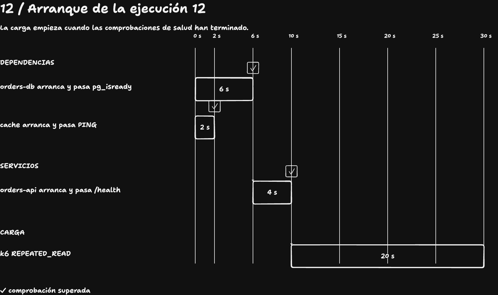

- **`--wait`** hace que `docker compose up` no termine hasta que todos los servicios estén sanos, o falle si alguno no lo consigue a tiempo.
- **La carga arranca después.** Solo cuando `up --wait` termina bien, el motor lanza k6.
- **Cada espera tiene un límite.** Si una imagen no se descarga o un servicio no llega a estar sano, la ejecución pasa a fallida, se registra el motivo y se limpia.

### 9.5 Fase deseada y limpieza por etiqueta

El `ExecutionReconciler` funciona como un bucle de control: compara **lo que se quiere** con **lo que hay** y actúa hasta que coinciden.

| Lo que ocurre | Fase deseada |
| --- | --- |
| El usuario pulsa `Run`. | `RUNNING` |
| El usuario pulsa `Stop`. | `STOPPED` |
| Se agota el tiempo máximo (30 minutos por defecto). | `STOPPED` |
| Falla Docker, una imagen o la salud. | `STOPPED` |
| Se borra el escenario, el proyecto o la cuenta. | `STOPPED` |
| El backend se reinicia y encuentra una ejecución inconclusa. | `STOPPED` |

Todas las formas de terminar piden lo mismo. Para alcanzar `STOPPED`, el motor sigue siempre la misma secuencia:

1. Detiene k6 para que no se genere más trabajo.
2. Recoge las últimas métricas disponibles.
3. Ejecuta `docker compose -p infracture-exec-12 down -v`, que retira contenedores, red y volúmenes temporales.
4. Comprueba por etiqueta (`io.infracture.execution=12`) que no queda nada. Si queda algo, lo retira y vuelve a comprobar.
5. Registra el resultado y libera la reserva.

No se guarda en qué paso iba el arranque, porque nunca se reanuda ([ADR 0005](adr/0005-recuperacion-sin-reanudacion-automatica.md)). Tras una caída, el backend solo necesita saber qué ejecuciones estaban abiertas y retirar todo lo que lleve su etiqueta. Si la limpieza falla, se registra, `Run` sigue bloqueado y la limpieza se puede reintentar sin efectos duplicados. La limpieza filtra siempre por las etiquetas de Infracture, nunca por nombres parecidos, para no tocar contenedores ajenos.

### 9.6 Acceso a Docker desde el backend contenedorizado

En la distribución, el backend corre dentro de un contenedor. Para crear los contenedores del experimento usa el Docker de la máquina a través de un proxy:

```yaml
services:
  infracture:
    environment:
      DOCKER_HOST: tcp://docker-proxy:2375
  docker-proxy:
    image: tecnativa/docker-socket-proxy
    environment: { CONTAINERS: 1, NETWORKS: 1, VOLUMES: 1, IMAGES: 1, POST: 1 }
    volumes: ["/var/run/docker.sock:/var/run/docker.sock:ro"]
```

| | Docker de la máquina con proxy (elegida) | Docker in Docker (descartada) |
| --- | --- | --- |
| Privilegios | El socket equivale a administrador; el proxy limita las operaciones. | `--privileged`, que también equivale a administrador. |
| Recursos | Reutiliza el motor y la caché de imágenes. | Un segundo motor con su propia caché. |
| Redes | El backend se une a la red de cada ejecución para medir, sin publicar puertos. | Las redes quedan dentro del otro motor. |
| Plataformas | Linux y Docker Desktop (macOS y Windows). | Problemas de almacenamiento en algunos sistemas. |

**Prueba al empezar P06.** Antes de programar el motor, una prueba corta en macOS, Windows y Linux confirmará tres cosas: que el CLI funciona desde el contenedor, que el backend puede unirse a la red de una ejecución y que la limpieza por etiqueta no toca otros contenedores. Si el CLI falla, se usa `docker-java` con el mismo plan.

## 10. Ciclo de vida de una Execution

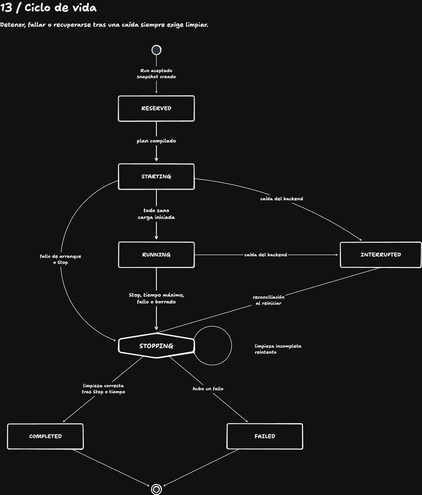

- **Una interrupción nunca es un éxito.** Tras una caída, la ejecución queda registrada como interrumpida, conserva su snapshot y sus evidencias, y se limpia sin reanudarse.
- **Cerrar el navegador no es Stop.** La ejecución sigue hasta que alguien la detiene o se agota el tiempo, y se puede volver a consultar.
- **Nombres por confirmar.** `STOPPING`, `COMPLETED` y `FAILED` ya aparecen en la spec. Los nombres exactos del resto de estados se fijan al implementar P06 (condición C05).

## 11. Observación: salud, métricas y eventos

### 11.1 Proceso activo frente a servicio sano

- **Running:** el proceso del contenedor sigue vivo.
- **Healthy:** la comprobación específica del servicio responde bien.

Un contenedor puede estar activo y no estar sano, por ejemplo mientras PostgreSQL arranca. La interfaz muestra los dos estados por separado.

### 11.2 Qué mide cada tipo

Cada `ComponentDriver` declara sus métricas y de dónde se leen. Un único `TelemetryCollector` las recoge todas con el mismo bucle.

| Tipo | Salud | Métricas propias | Fuente |
| --- | --- | --- | --- |
| Todos | — | CPU y memoria | API de estadísticas de Docker. |
| HTTP Service | `GET /health` | Peticiones, errores, latencia, `cache_hits`, `cache_misses`, `database_queries`, tareas publicadas | Endpoint `/metrics` (formato Prometheus) de la imagen de demostración. |
| Worker | Señal de salud de la imagen | Tareas procesadas, fallidas y reintentadas; tiempo de proceso | `/metrics` de la imagen de demostración. |
| PostgreSQL | `pg_isready` | Conexiones activas | Docker y consulta de estado. |
| Redis | `redis-cli ping` | Memoria y claves | Comando `INFO`. |
| RabbitMQ | Diagnóstico del broker | Mensajes preparados, sin confirmar, publicados y consumidos | API de gestión de RabbitMQ. |
| Workload (k6) | Progreso de k6 | Peticiones, errores, latencia media y p95, rendimiento | Resultados agregados de k6. |
| Load Balancer | Comprobaciones de HAProxy | Tráfico y estado de cada backend | Endpoint Prometheus de HAProxy. |

Para leer esas fuentes, el backend se une a la red de la ejecución. No hace falta publicar puertos en la máquina.

### 11.3 Muestras, eventos y SSE

- **`MetricSample`.** Valor agregado por intervalo y ligado a un `ExecutedComponent`. Nunca se guarda una fila por petición.
- **`ExecutionEvent`.** Cambio significativo: arranque, salud alcanzada, fallo, `Stop`, limpieza.
- **SSE.** El navegador recibe eventos y muestras en directo por Server-Sent Events autorizados. Si se corta la conexión, se reconecta y recupera lo que falta sin duplicar.
- **Ausente no es cero.** Una muestra que no se pudo recoger se muestra como ausente, y un resultado incompleto como incompleto.

```json
{
  "component": "orders-api",
  "interval": "2026-10-30T18:42:10Z/PT5S",
  "requestCount": 50,
  "failedRequests": 0,
  "averageLatencyMs": 12,
  "p95LatencyMs": 31,
  "cacheHits": 46,
  "cacheMisses": 4
}
```

## 12. Snapshot e historial

Al reservar la ejecución, Infracture congela en el `Execution snapshot` todo lo necesario para explicar después qué se ejecutó:

| Contenido | Por qué |
| --- | --- |
| Revisión del escenario: nodos, conexiones y `Workload` | Es el diseño exacto que se validó. |
| Versión del contrato de cada nodo | Permite interpretar sus parámetros aunque el contrato cambie después. |
| Imagen y digest de cada servicio | Identifica el código que corrió. |
| `ExecutionPlan` compilado, sin secretos | Es la configuración real aplicada. Recalcularlo con una release posterior daría otro plan. |
| Versión de Infracture | Sitúa la ejecución en el tiempo del producto. |

Las métricas y eventos apuntan a `ExecutedComponent` y `ExecutedConnection`, no a los nodos editables. Así, editar o borrar nodos del canvas no altera el historial ([ADR 0004](adr/0004-ejecuciones-ligadas-a-una-revision-inmutable.md)).

Retención inicial, configurable:

| Dato | Se conserva |
| --- | --- |
| Logs resumidos | 7 días |
| Métricas y eventos | 30 días |
| Resumen y snapshot | Hasta borrar el escenario, el proyecto o la cuenta |

## 13. Recorridos de ejemplo

### 13.1 Caché con `CACHE_ASIDE`

Redis no se conecta a PostgreSQL. Es el servicio quien coordina los dos:

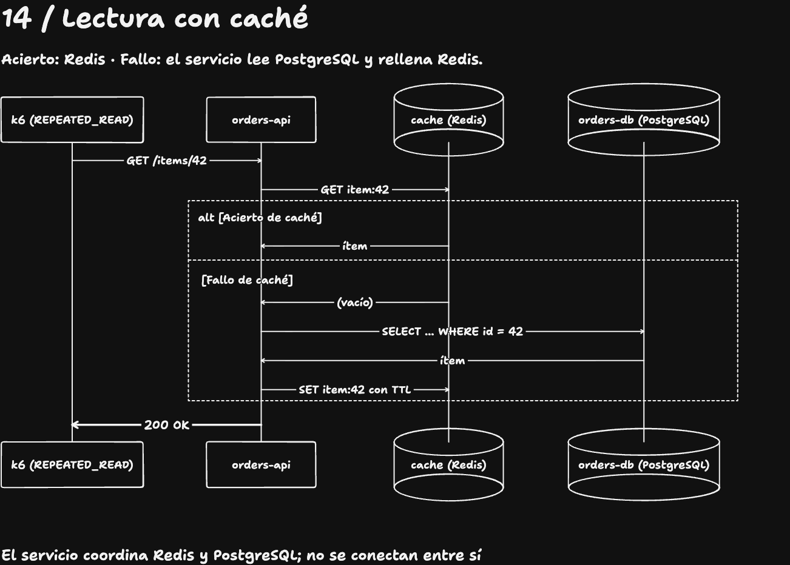

Al modificar un ítem, el servicio actualiza PostgreSQL y borra la entrada de Redis. La siguiente lectura vuelve a llenar la caché. Las evidencias muestran cómo suben los aciertos a medida que la caché se calienta.

### 13.2 Tareas con RabbitMQ

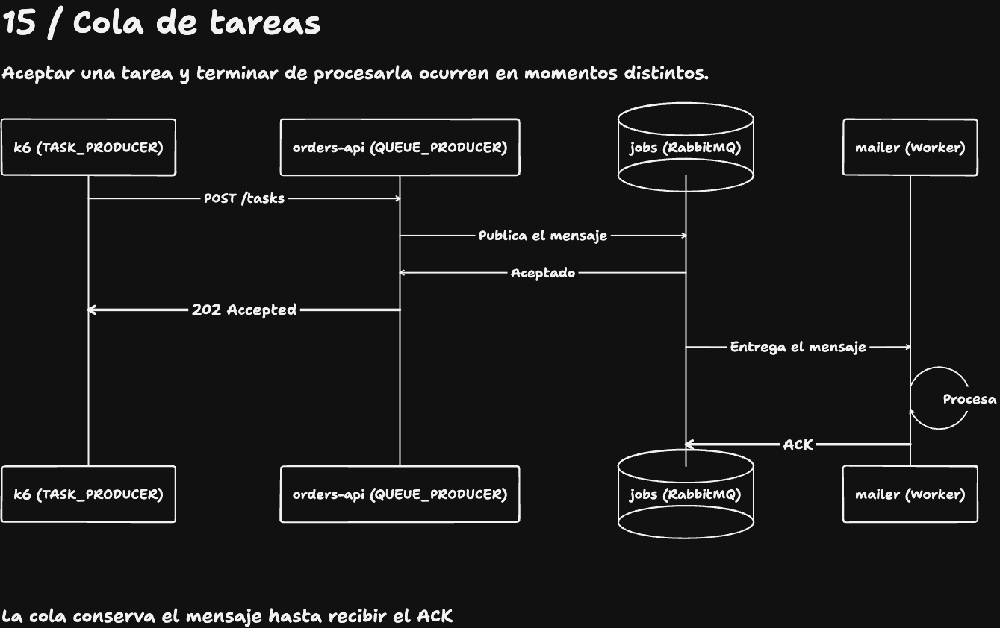

Sin Worker, las tareas se acumulan en la cola. Mientras se procesa, un mensaje está sin confirmar. Tras el `ACK`, RabbitMQ lo elimina. Si el Worker desaparece antes de confirmar, el mensaje vuelve a la cola.

### 13.3 Cadena de servicios

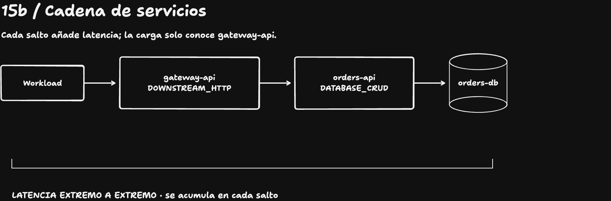

La carga solo conoce `gateway-api`. Este conoce `orders-api` por la variable que le genera Infracture, y `orders-api` conoce `orders-db`. Sirve para estudiar cómo se suma la latencia a lo largo de una cadena.

## 14. Load Balancer

El Load Balancer es el sexto `ComponentType` de 0.1.0. Se implementa con HAProxy y se construye en P07, cuando el motor ya ejecuta los otros cinco tipos.

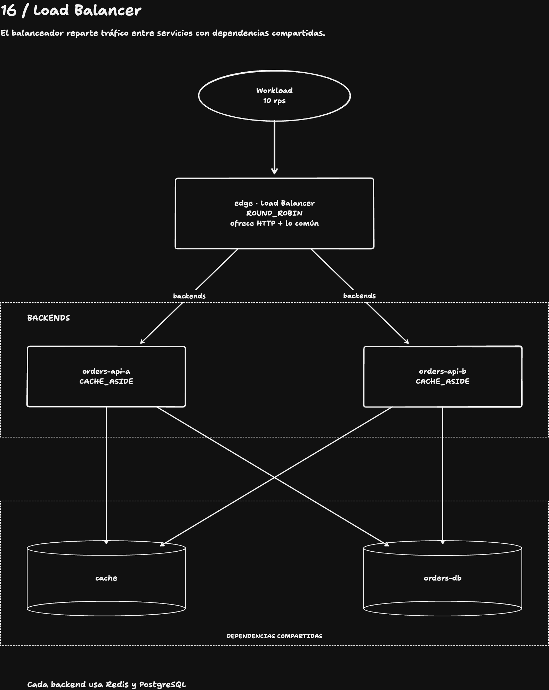

| Elemento | Diseño |
| --- | --- |
| Perfiles | `ROUND_ROBIN` (reparto por turnos) y `LEAST_CONNECTIONS` (al que tenga menos conexiones abiertas). |
| Puerto | `backends`, que pide `HTTP` y admite de 1 a N conexiones. |
| Capacidades | Ofrece `HTTP` más las capacidades que comparten **todos** sus backends. Con dos `CACHE_ASIDE`, ofrece también `RESOURCE_READ` y `RESOURCE_WRITE`, así que un `Workload` `REPEATED_READ` puede apuntar a él. |
| Parámetros | Intervalo de comprobación de salud, fallos seguidos para retirar un backend y éxitos seguidos para devolverlo. |
| Comportamiento | Comprobaciones de salud activas: un backend caído deja de recibir tráfico y vuelve cuando se recupera. |
| Evidencias | Tráfico y estado de cada backend, leídos del endpoint Prometheus de HAProxy. |

Con el modelo de capacidades, el Load Balancer no obliga a cambiar el HTTP Service ni el `Workload`. Basta con declarar su contrato y escribir su driver.

## 15. Evolución fuera de la Fase 3

Estas piezas no forman parte de 0.1.0. El diseño actual las deja preparadas sin construirlas:

| Pieza futura | Qué haría | Qué la deja preparada |
| --- | --- | --- |
| Fallos controlados | Parar, reiniciar o pausar un nodo e introducir latencia en una conexión con Toxiproxy. | Las direcciones de las dependencias ya llegan por variable de entorno, así que el compilador podrá apuntarlas a un proxy sin tocar las imágenes. |
| Análisis de impacto | Calcular con un recorrido en anchura (BFS) qué nodos se ven afectados por un fallo. | El grafo ya es acíclico y sus dependencias están explícitas. |
| Laboratorios guiados | Escenarios con objetivos, pistas y evaluación. | El snapshot y las evidencias ya identifican qué se ejecutó y qué se midió. |
| Otros destinos de ejecución | Traducir el mismo plan a Kubernetes. | El `ExecutionPlan` usa conceptos comunes (servicios, salud, dependencias, etiquetas) y el `RuntimeEngine` está aislado. |

## 16. Mapa al código

El backend es un monolito modular. Cada módulo sigue las capas `api`, `application`, `domain` y `persistence`.

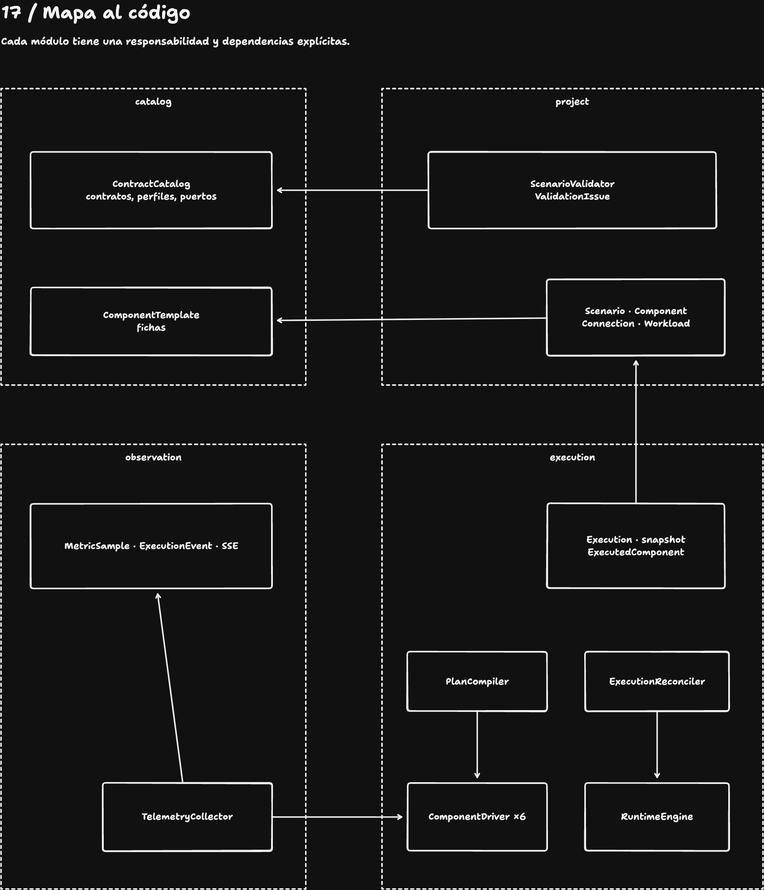

| Pieza | Módulo | Estado |
| --- | --- | --- |
| `ComponentTemplate`, lectura del catálogo | `catalog` | Implementado. |
| `ContractCatalog`, `ProfileContract`, `ParameterContract` | `catalog` | En desarrollo (#79). |
| Guardado del grafo con revisión esperada | `project` | En desarrollo (#79). |
| `Connection`, puertos y capacidades | `project` | Pendiente (#80). |
| `ScenarioValidator`, `ValidationIssue` | `project` | Pendiente. |
| `Workload` | `project` | Pendiente. |
| Motor: `PlanCompiler`, drivers, `RuntimeEngine`, `ExecutionReconciler` | `execution` | Pendiente (P06–P07). |
| Observación e historial | `observation` | Pendiente (P08). |
| Load Balancer | `catalog`, `execution` | Pendiente (P07). |

Los nombres de clases son los previstos. Pueden ajustarse al implementar si se conserva la responsabilidad de cada pieza.

## 17. Decisiones y referencias

### Decisiones que fijan este diseño

| ADR | Decisión |
| --- | --- |
| [0003](adr/0003-catalogo-controlado-con-contratos-versionados.md) | Catálogo controlado con contratos. |
| [0004](adr/0004-ejecuciones-ligadas-a-una-revision-inmutable.md) | Ejecuciones ligadas a una revisión inmutable. |
| [0005](adr/0005-recuperacion-sin-reanudacion-automatica.md) | Recuperación sin reanudación automática. |
| [0010](adr/0010-una-sola-version-ejecutable-del-contrato.md) | Una sola versión ejecutable del contrato. |
| [0011](adr/0011-puertos-con-nombre-que-piden-capacidades.md) | Puertos con nombre que piden capacidades. |
| [0012](adr/0012-la-carga-es-un-workload-del-escenario.md) | La carga es un `Workload` del escenario. |
| [0013](adr/0013-motor-de-ejecucion-con-docker-compose.md) | Motor de ejecución con Docker Compose. |

### Referencias para aprender

- [Docker Compose: servicios, `depends_on` y `healthcheck`](https://docs.docker.com/reference/compose-file/services/)
- [Docker Compose: `up --wait`](https://docs.docker.com/reference/cli/docker/compose/up/)
- [Docker: redes de contenedores](https://docs.docker.com/engine/network/)
- [Tecnativa docker-socket-proxy](https://github.com/Tecnativa/docker-socket-proxy)
- [OASIS TOSCA: requirements y capabilities](https://docs.oasis-open.org/tosca/TOSCA/v2.0/TOSCA-v2.0.html)
- [Kubernetes: el patrón controlador](https://kubernetes.io/docs/concepts/architecture/controller/)
- [Grafana k6: ejecutar pruebas de carga](https://grafana.com/docs/k6/latest/get-started/running-k6/)
- [HAProxy: comprobaciones de salud](https://www.haproxy.com/documentation/haproxy-configuration-tutorials/reliability/health-checks/)
- [Spring Boot Actuator: salud y métricas](https://docs.spring.io/spring-boot/reference/actuator/endpoints.html)
- [Redis: tipos de datos](https://redis.io/docs/latest/develop/data-types/)
- [RabbitMQ: Work Queues con Java](https://www.rabbitmq.com/tutorials/tutorial-two-java)
- [Toxiproxy: simulación de condiciones de red](https://github.com/Shopify/toxiproxy)
- [Google SRE: monitorización de sistemas distribuidos](https://sre.google/sre-book/monitoring-distributed-systems/)
